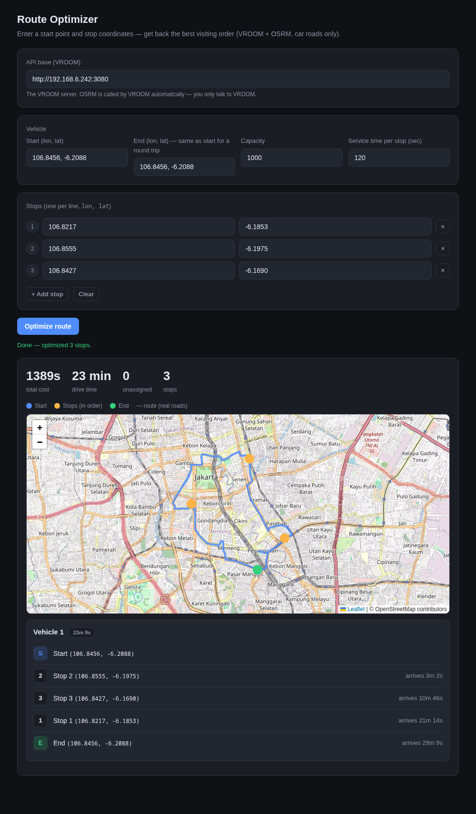

# Route Optimization Backend (Indonesia) — Java Island Deployment

An open, Docker-deployable backend that provides **car route optimization** for
Indonesia (Java island). It combines two battle-tested open-source engines:

- **[OSRM](https://github.com/Project-OSRM/osrm-backend)** — routing engine that
  computes routes and distance matrices on **car-accessible roads only** (via the
  `car.lua` profile).
- **[VROOM](https://github.com/VROOM-Project/vroom)** — a vehicle routing problem
  (VRP) solver that decides which vehicle visits which jobs in what order, using
  OSRM as its router.

The "cars only" constraint is enforced by OSRM's `car.lua` profile, not the
optimizer. VROOM just consumes the routes OSRM gives it.

> **Map data:** Java island (Jakarta, Bandung, Surabaya, Semarang, Yogyakarta,
> Malang, etc.). Rebuild with the full `indonesia-latest.osm.pbf` to cover all
> of Indonesia.

---

## Contents

1. [The web UI](#1-the-web-ui)
2. [API — quick start](#2-api--quick-start)
3. [API — full reference](#3-api--full-reference)
4. [Output variables (what you get back)](#4-output-variables)
5. [Architecture](#5-architecture)
6. [Setup](#6-setup)
7. [Deployment](#7-deployment)
8. [Operations](#8-operations)
9. [Pitfalls](#9-pitfalls)

---

## 1. The web UI

A single-file, dependency-free frontend is included: **`route-optimizer.html`**.
Open it, enter a start point and stop coordinates, click **Optimize route**, and
it calls VROOM and renders the best visiting order **plus a map** with the real
driving route (Leaflet + OpenStreetMap, geometry from OSRM).



**Live:** served from the deployment host on port 8080:
```
http://192.168.6.242:8080/route-optimizer.html
```
**Or run it locally** (or just open the file directly):
```bash
python3 -m http.server 8099 --directory .
# then open http://localhost:8099/route-optimizer.html
```

The UI is a single `fetch` to `POST /` — no build step, no dependencies. The API
base field defaults to the deployment VROOM; edit it to point at any instance.

---

## 2. API — quick start

| Service | Base URL |
|---------|----------|
| **VROOM** (optimization) | `http://192.168.6.242:3080` |
| **OSRM** (routing) | `http://192.168.6.242:5000` |

**Coordinate order everywhere is `[lon, lat]`** (longitude first).

### VROOM — optimize a set of deliveries

```bash
curl "http://192.168.6.242:3080/" -X POST -H "Content-Type: application/json" -d '{
  "vehicles": [
    { "id": 1, "start": [106.8456, -6.2088], "end": [106.8456, -6.2088], "capacity": [100] }
  ],
  "jobs": [
    { "id": 1, "location": [106.8217, -6.1853], "delivery": [30], "service": 120 },
    { "id": 2, "location": [106.8555, -6.1975], "delivery": [50], "service": 120 },
    { "id": 3, "location": [106.8427, -6.1690], "delivery": [20], "service": 120 }
  ]
}'
```

### OSRM — fastest route between two points

```bash
curl "http://192.168.6.242:5000/route/v1/car/106.8456,-6.2088;106.8063,-6.2573?overview=full&geometries=geojson"
```

> **The #1 integration mistakes (all real):**
> - **IDs must be integers** (VROOM v1.14). `"id": "van-1"` fails.
> - **Coordinates are `[lon, lat]`** — longitude first. `[lat, lon]` routes across
>   the ocean.
> - The VROOM endpoint is `POST /` (root), **not** `/api/v1/optimization`.
> - With `location`/`start`/`end` coordinates, VROOM asks OSRM for real travel
>   times automatically — no `matrices` block needed.
> - `capacity` must be ≥ the sum of `delivery`, or jobs come back `unassigned`.

---

## 3. API — full reference

### 3.1 VROOM — vehicle routing optimization

`POST /` (root). Content-Type: `application/json`.

**Limits:** max payload 1 MB · max 1000 locations · max 200 vehicles · timeout 300 s.

#### `vehicles[]`

| Field | Type | Required | Notes |
|-------|------|:--------:|-------|
| `id` | int | ✅ | **Must be an integer** (not a string). |
| `start` | `[lon, lat]` | ✅* | Departure. *Omit only if using `start_index` with a custom matrix. |
| `end` | `[lon, lat]` | ✅* | Return point. Same as `start` for a round trip. |
| `capacity` | `[int]` | — | Max load per dimension. Must be ≥ sum of `delivery` for the jobs it serves. |
| `profile` | string | — | Routing profile. Defaults to `car`. |
| `time_window` | `[unix, unix]` | — | Working hours (epoch seconds). |
| `breaks` | `[break]` | — | Driver breaks. |
| `skills` | `[int]` | — | Skills the vehicle has; jobs/shipments require a match. |

#### `jobs[]`

| Field | Type | Required | Notes |
|-------|------|:--------:|-------|
| `id` | int | ✅ | **Must be an integer.** |
| `location` | `[lon, lat]` | ✅* | The stop. *Omit only if using `location_index` with a custom matrix. |
| `delivery` | `[int]` | — | Units delivered here (per dimension). |
| `pickup` | `[int]` | — | Units picked up here (per dimension). |
| `service` | int | — | Service time at the stop, seconds. |
| `setup` | int | — | Setup time before service, seconds. |
| `time_windows` | `[[unix, unix]]` | — | Allowed service windows. |
| `skills` | `[int]` | — | Skills required to serve this job. |
| `priority` | int | — | 0–100; higher served first if capacity is tight. |

#### `shipments[]` (pickup-and-delivery pair, same route)

```json
{
  "amount": [1],
  "skills": [1],
  "pickup":   { "id": 10, "location": [106.81, -6.20], "service": 120 },
  "delivery": { "id": 11, "location": [106.85, -6.19], "service": 120 }
}
```

#### `matrices` (only if you omit coordinates)

```json
{ "car": { "durations": [[0, 182, 532], [182, 0, 350], [532, 350, 0]] } }
```
Use `start_index`/`end_index`/`location_index` to refer into the matrix. When you
provide real coordinates instead, VROOM fetches the matrix from OSRM
automatically — you don't need this.

#### Example: two vehicles, six jobs

```json
{
  "vehicles": [
    { "id": 1, "start": [106.8456, -6.2088], "end": [106.8456, -6.2088], "capacity": [200] },
    { "id": 2, "start": [106.8456, -6.2088], "end": [106.8456, -6.2088], "capacity": [200] }
  ],
  "jobs": [
    { "id": 1, "location": [106.8217, -6.1853], "delivery": [40], "service": 120 },
    { "id": 2, "location": [106.8555, -6.1975], "delivery": [60], "service": 120 },
    { "id": 3, "location": [106.8427, -6.1690], "delivery": [30], "service": 120 },
    { "id": 4, "location": [106.8063, -6.2573], "delivery": [50], "service": 120 },
    { "id": 5, "location": [106.8750, -6.2000], "delivery": [45], "service": 120 },
    { "id": 6, "location": [106.8100, -6.1900], "delivery": [25], "service": 120 }
  ]
}
```

### 3.2 OSRM — point-to-point routing

Base: `http://192.168.6.242:5000`. All URL coordinates are `lon,lat`.

> OSRM has **no `/health` endpoint**. Probe with a `/route` call; `code: "Ok"`
> means it is up.

| Endpoint | Purpose |
|----------|---------|
| `GET /route/v1/car/{coords}` | Fastest car route (+ geometry, alternatives, steps) |
| `GET /table/v1/car/{coords}` | N×N distance/duration matrix (up to 1000 coords) |
| `GET /nearest/v1/car/{coord}` | Nearest routable nodes |
| `POST /match/v1/car` | Map-match a GPS trace |

**`/route` query params:** `overview` (`false`/`simplified`/`full`), `geometries`
(`geojson`/`polyline`/`poly6`/`poly5`/`poly4`), `alternatives` (`true`/`false`),
`steps` (`true`/`false`), `annotations` (`distance`, `duration`, `speed`, …).

**`/table` query params:** `annotations` (comma list of `distance`, `duration`,
`speed`), `fail_if_incomplete` (`true`/`false`).

**`/nearest` query params:** `number` (how many, default 1), `range` (max search
radius, meters).

**`/match` body:** `{ "traces": [[lon, lat], …], "radiuses": [50, …] }`; query
params `interpolate`, `annotations`.

**Examples:**
```bash
# Fastest route with geometry
curl "http://192.168.6.242:5000/route/v1/car/106.8456,-6.2088;106.8063,-6.2573?overview=full&geometries=geojson"
# Distance matrix
curl "http://192.168.6.242:5000/table/v1/car/106.8456,-6.2088;106.8217,-6.1853;106.8555,-6.1975?annotations=duration,distance"
# Nearest nodes
curl "http://192.168.6.242:5000/nearest/v1/car/106.8456,-6.2088?number=5"
```

---

## 4. Output variables

### 4.1 VROOM response

```json
{
  "code": 0,
  "summary": {
    "cost": 1389, "routes": 1, "unassigned": 0,
    "delivery": [100], "amount": [100], "pickup": [0],
    "setup": 0, "service": 360, "duration": 1389, "waiting_time": 0,
    "priority": 0, "violations": [],
    "computing_times": { "loading": 20, "solving": 0, "routing": 0 }
  },
  "routes": [
    {
      "vehicle": 1, "cost": 1389, "delivery": [100], "service": 360,
      "steps": [
        { "type": "start", "location": [106.8456, -6.2088], "arrival": 0, "load": [100] },
        { "type": "job", "id": 2, "location": [106.8555, -6.1975], "arrival": 182, "load": [50], "service": 120 },
        { "type": "job", "id": 3, "location": [106.8427, -6.1690], "arrival": 646, "load": [30], "service": 120 },
        { "type": "job", "id": 1, "location": [106.8217, -6.1853], "arrival": 1274, "load": [0], "service": 120 },
        { "type": "end", "location": [106.8456, -6.2088], "arrival": 1749 }
      ]
    }
  ],
  "unassigned": []
}
```

#### Top-level

| Variable | Type | Meaning |
|----------|------|---------|
| `code` | int | `0` success · `2` bad request · `3` server/timeout. |
| `error` | string | Present when `code ≠ 0`; the error message. |
| `summary` | object | Aggregate indicators (below). |
| `routes` | array | One object per vehicle route (below). |
| `unassigned` | array | Jobs that couldn't be assigned (below). |

#### `summary`

| Variable | Type | Meaning |
|----------|------|---------|
| `cost` | int | Total route cost, seconds. |
| `routes` | int | Number of routes. |
| `unassigned` | int | Count of unassigned jobs. |
| `delivery` | `[int]` | Total delivered, per dimension. |
| `pickup` | `[int]` | Total picked up, per dimension. |
| `amount` | `[int]` | Total amount moved, per dimension. |
| `setup` | int | Total setup time, seconds. |
| `service` | int | Total service time, seconds. |
| `waiting_time` | int | Total waiting time, seconds. |
| `duration` | int | Total duration, seconds. |
| `priority` | int | Total priority weight. |
| `violations` | array | Constraint violations (empty if none). |
| `computing_times` | object | `{ loading, solving, routing }` in ms. |

#### `routes[]`

| Variable | Type | Meaning |
|----------|------|---------|
| `vehicle` | int | The vehicle id. |
| `cost` | int | This route's cost, seconds. |
| `delivery` / `pickup` / `amount` | `[int]` | Totals for this route, per dimension. |
| `service` / `setup` / `waiting_time` | int | Totals for this route, seconds. |
| `steps` | array | The ordered steps (below). |

#### `routes[].steps[]`

| Variable | Type | Meaning |
|----------|------|---------|
| `type` | string | `start` \| `job` \| `pickup` \| `delivery` \| `break` \| `end`. |
| `id` | int | The job/shipment id (for non start/end). |
| `location` | `[lon, lat]` | The step's coordinates. |
| `arrival` | int | Seconds from the vehicle's start. |
| `load` | `[int]` | Remaining load after the step, per dimension. |
| `service` / `setup` / `waiting_time` | int | Seconds for that step. |
| `violations` | array | Violations at this step (usually empty). |

#### `unassigned[]`

| Variable | Type | Meaning |
|----------|------|---------|
| `id` | int | The unassigned job/shipment id. |
| `type` | string | `job` \| `pickup` \| `delivery`. |
| `reason` | string | Why it was not assigned. |

### 4.2 OSRM response

**`/route`:**
| Variable | Type | Meaning |
|----------|------|---------|
| `code` | string | `"Ok"` · `"NoRoute"` · `"NotFound"`. |
| `routes[]` | array | Up to 3 routes (with `alternatives=true`). |
| `routes[].distance` | float | Meters. |
| `routes[].duration` | float | Seconds. |
| `routes[].geometry` | object | GeoJSON `LineString`; `coordinates` is `[lon, lat]`. |
| `routes[].legs[]` | array | Per-leg `distance`, `duration`, `steps[]`. |

**`/table`:**
| Variable | Type | Meaning |
|----------|------|---------|
| `code` | string | `"Ok"`. |
| `durations` | `[[float]]` | N×N matrix, seconds. Row `i`, col `j` = from coord `i` to `j`. |
| `distances` | `[[float]]` | N×N matrix, meters. |

**`/nearest`:**
| Variable | Type | Meaning |
|----------|------|---------|
| `code` | string | `"Ok"`. |
| `coordinates` | `[[lon, lat]]` | The matched node coordinates. |
| `matched[]` | array | `{ distance, name, location }` per node. |

**`/match`:**
| Variable | Type | Meaning |
|----------|------|---------|
| `code` | string | `"Ok"`. |
| `traces[]` | array | Per-trace `distance`, `duration`, `geometry`. |

### 4.3 Quick error reference

| Service | Success | Failure signals |
|---------|---------|-----------------|
| VROOM | `code: 0` | `code: 2` (bad request, see `error`), `code: 3` (timeout) |
| OSRM | `code: "Ok"` | `code: "NoRoute"`, `code: "NotFound"`, `code: "InvalidNv"` |

---

## 4.5 Displaying the map with the route in your own apps

**The API does not stitch or render.** VROOM returns the optimized *order*
(no geometry); OSRM returns the *road geometry for one leg* only. **Both the
leg-stitching and the map rendering happen on the frontend (your client).**

### Start here (for agents)

> **There is a complete, self-contained, runnable file: [`frontend-map-example.html`](frontend-map-example.html).**
> Open it in a browser and it works end-to-end (VROOM → order → OSRM per-leg
> geometry → stitch → Leaflet/OSM render). Read its four functions —
> `getOptimizedOrder()`, `stitchRoute()`, `renderRoute()`, and the `run` handler —
> for the exact, tested implementation. The steps below are what that file does.

### The 4-step workflow (what the example file does)

1. **Get the order** — `POST {vroomBase}/`. From the response, collect
   `routes[0].steps[].location` (`[lon, lat]`) **in order** (start → stops →
   end). Skip steps with no `location`.
   ```js
   const order = d.routes[0].steps.filter(s => s.location).map(s => s.location);
   ```
2. **Fetch road geometry per leg** — for each consecutive pair
   `(order[i], order[i+1])`, call OSRM
   `GET {osrmBase}/route/v1/car/{lon},{lat};{lon},{lat}?overview=full&geometries=geojson`
   and read `routes[0].geometry.coordinates` (a `[lon, lat]` polyline of the real
   road).
3. **Stitch the legs** — concatenate the per-leg polylines. After the first leg,
   `shift()` off the first point of each leg (it duplicates the shared node).
   If a leg fails / has no route, fall back to a straight line for that leg.
4. **Render** — plot the stitched polyline plus a marker per point. **Swap
   `[lon, lat]` → `[lat, lon]`** for Leaflet.

### Minimal Leaflet + OpenStreetMap (no API key)

```html
<link rel="stylesheet" href="https://unpkg.com/leaflet@1.9.4/dist/leaflet.css">
<script src="https://unpkg.com/leaflet@1.9.4/dist/leaflet.js"></script>
<div id="map" style="height:420px"></div>
<script>
const map = L.map('map').setView([-6.2, 106.84], 12);
L.tileLayer('https://{s}.tile.openstreetmap.org/{z}/{x}/{y}.png', {
  maxZoom: 19, attribution: '&copy; OpenStreetMap contributors'
}).addTo(map);

async function drawRoute(order, osrmBase) {
  const full = [];
  for (let i = 0; i < order.length - 1; i++) {
    const [a, b] = [order[i], order[i + 1]];
    const url = `${osrmBase}/route/v1/car/${a[0]},${a[1]};${b[0]},${b[1]}?overview=full&geometries=geojson`;
    const j = await (await fetch(url)).json();
    if (j.code === 'Ok' && j.routes[0].geometry) {
      const coords = j.routes[0].geometry.coordinates;
      if (i > 0) coords.shift();          // drop the duplicated shared node
      full.push(...coords);
    } else {
      if (i > 0) full.push(a);            // fallback: straight line
      full.push(b);
    }
  }
  L.polyline(full.map(c => [c[1], c[0]]), { color: '#4f8cff', weight: 4 }).addTo(map);
  order.forEach((p, i) => {
    L.circleMarker([p[1], p[0]], { radius: 8, color: i === 0 ? '#4f8cff' : i === order.length - 1 ? '#34d17b' : '#ffb347', fillOpacity: 1 }).addTo(map);
  });
  map.fitBounds(L.latLngBounds(order.map(p => [p[1], p[0]])), { padding: [40, 40] });
}
</script>
```

### Notes / gotchas
- **`[lon, lat]` → `[lat, lon]`:** OSRM returns `[lon, lat]`; Leaflet wants
  `[lat, lon]`. Swap when plotting.
- **One OSRM call per leg:** N stops = N-1 OSRM calls. Cheap for one vehicle;
  for many vehicles/legs, batch or cache.
- **No API key needed:** OpenStreetMap tiles are free. For high volume, use a
  keyed tile provider (Mapbox, etc.) — only the tile URL changes.
- **Two reference files in this repo:**
  - `frontend-map-example.html` — **minimal, self-contained, runnable** (start here).
  - `route-optimizer.html` — the full UI with input forms + the same `drawRoute()`
    logic (the one shown in the screenshot).

---

## 5. Architecture

```
                 +---------------------------+
    App / Agent  |   VROOM (port 3080)        |
    (HTTP)  ---> |  vroom-express server      |
                 +-----------+---------------+
                               |  (OSRM router)
                               v
                 +---------------------------+
                 |   OSRM (port 5000)         |
                 |  osrm-routed (car.lua)     |
                 |  MLD algorithm             |
                 +---------------------------+
                               |
                               v
                 pre-built routing data
                 (osrm-data/java-latest.osrm)
                 built once from OSM PBF
```

- **OSRM** owns the map — serves the pre-processed road network, answers
  `/route`, `/table`, `/match`, `/nearest`.
- **VROOM** owns the optimization — solves the VRP and returns the optimal visit
  order per vehicle with arrival times and total cost.
- Neither is modified; the whole stack is stock, Docker-deployable images.

**Car-accessible roads only:** OSRM's `car.lua` profile excludes `footway`,
`path`, `pedestrian`, `cycleway`, `steps`, and ways with `motorcar=no`,
`access=no`, `access=private`, and penalizes `highway=service`.

---

## 6. Setup

### 6.1 Prerequisites
- Docker + Docker Compose on the build machine.
- **Build (one-time):** `osrm-extract` is memory-hungry — **~12 GB peak RAM**
  for Java island. It is OOM-killed on a 4 GB box. Build on a machine with
  ≥16 GB RAM, then transfer the result to the serving host.
- **Serve (runtime):** 4 GB RAM, 2+ vCPU, ~8 GB disk (Java island).

### 6.2 Download the OSM data
```bash
curl -sL -o osm-java-latest.osm.pbf \
  https://download.geofabrik.de/asia/indonesia/java-latest.osm.pbf
```

### 6.3 Pre-process into an OSRM database (one-time, 20–60 min)
```bash
./preprocess-osrm.sh
```

### 6.4 Start
```bash
docker compose up -d
# OSRM: http://localhost:5000   VROOM: http://localhost:3080
```

---

## 7. Deployment

The reference deployment is on a Proxmox host as an LXC running Docker. See
[`deploy-to-proxmox.sh`](deploy-to-proxmox.sh) for the automated, idempotent
provisioning (LXC create → AppArmor fix → Docker → repo clone → OSRM data
transfer → image pin → start). Key facts:

- **LXC:** Ubuntu 24.04, 4 vCPU / 4 GB RAM, 8 GB rootfs.
- **OSRM image is pinned by digest** — the pre-built `.osrm` data must be
  served by the same OSRM version that built it, or it is rejected as
  incompatible. If you rebuild the data, update the digest.
- **Do not build the OSRM data inside a small LXC** — it OOMs. Build on a
  big-RAM machine and transfer the 4 GB `osrm-data/`.

---

## 8. Operations

```bash
# From the Proxmox host:
pct exec 201 -- systemctl status docker
pct exec 201 -- docker compose -f /opt/route-optimization-backend/docker-compose.yml ps
pct exec 201 -- docker logs osrm-car
pct exec 201 -- docker logs vroom-optimizer
pct restart 201
```

**After a host reboot:** re-run the host-side AppArmor fix (see Pitfalls) —
Docker will not start otherwise. The LXC is `onboot: 1`; the `eth0-config`
service re-applies the IP and Docker starts the containers.

**Updating map data:** re-download the PBF → re-run `./preprocess-osrm.sh` →
re-transfer `osrm-data/` → **re-pin the OSRM image digest** → `docker compose
down && up -d`.

---

## 9. Pitfalls (the ones we hit)

1. **`pct create --nameserver` fails on PVE 9.2** — create without the flag; add
   it to the conf file directly.
2. **Template won't unpack** (pre-start hook exits 32) — format + populate the LV
   manually.
3. **Docker blocked by AppArmor** — "Unable to replace docker-default. Access
   denied." The LXC can't load AppArmor profiles. Fix: load an empty
   `docker-default` profile on the **host** kernel (`apparmor_parser -W`).
4. **OSRM extract OOM-killed in the LXC** — needs ~12 GB peak; a 4 GB LXC dies.
   Build on a big-RAM machine and transfer the data.
5. **Transferring 4 GB fails** — `tar` hangs on the root-only `fileIndex` (use
   `sudo cp` + `chmod 644`); the host `/tmp` is a small tmpfs (use
   `/var/lib/vz/...`); `pct push <dir>/. <dir>/` fails (push each file).
6. **OSRM version mismatch** — `:latest` drifted between build and deploy; the
   data is rejected. Pin the image by digest.
7. **LXC network lost on restart** — use the `eth0-config` systemd service.

---

## Repository layout

```
route-optimization-deployment-java/
├── README.md                  # this file
├── API.md                     # complete API reference (VROOM + OSRM)
├── docs-screenshot.png        # the web UI
├── route-optimizer.html       # full web UI (map + optimized order) — see screenshot
├── frontend-map-example.html  # minimal, self-contained, runnable map example (start here)
├── docker-compose.yml         # OSRM + VROOM services (OSRM pinned by digest)
├── preprocess-osrm.sh         # one-time OSM -> OSRM build (run on big-RAM box)
├── deploy-to-proxmox.sh       # provision the LXC + deploy (idempotent-ish)
├── vroom-conf/
│   └── config.yml             # VROOM express config (router -> osrm-car:5000)
├── osm-*.osm.pbf              # (gitignored) downloaded OSM data
└── osrm-data/                 # (gitignored) built OSRM routing data
```

## References
- OSRM: https://github.com/Project-OSRM/osrm-backend
- VROOM: https://github.com/VROOM-Project/vroom
- VROOM API spec: https://github.com/VROOM-Project/vroom/blob/master/docs/API.md
- vroom-express: https://github.com/VROOM-Project/vroom-express
- Geofabrik Indonesia: https://download.geofabrik.de/asia/indonesia.html
